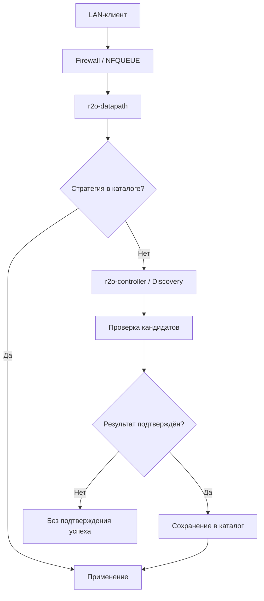

<div align="center">
  
  <h1>R2O</h1>
  <p><strong>Адаптивный сетевой обход на Rust</strong></p>
  <p>OpenWrt · ImmortalWrt · Keenetic</p>
  <a href="https://github.com/t0fox/r2o/releases/latest"></a>
  <a href="https://github.com/t0fox/r2o/actions/workflows/ci.yml"></a>
  <a href="LICENSE"></a>
  <p>
    <a href="#установка-по-ssh">Установка</a> ·
    <a href="#возможности">Возможности</a> ·
    <a href="#веб-панель-r2o">Панель</a> ·
    <a href="docs/README.md">Документация</a> ·
    <a href="https://github.com/t0fox/r2o/releases">Релизы</a>
  </p>
</div>

---

R2O обнаруживает сетевые ограничения на реальных соединениях, проверяет подходящие стратегии и сохраняет подтверждённые решения. Основной движок работает непосредственно на маршрутизаторе, без обязательного VPN, VPS, relay или WARP.

Datapath, контроллер и протокол стратегий реализованы на Rust. Для управления предусмотрена локальная веб-панель.

## Установка и релизы

### Установка по SSH

**Требования:** OpenWrt 24/25 или Keenetic с Entware, права root, поддержка NFQUEUE и conntrack, совместимый firewall, свободная память и место в /opt. Путь fw4 также проверен на ImmortalWrt.

Подключитесь к роутеру по SSH от root:

```sh
(apk -U add curl ca-bundle || (opkg update && opkg install curl ca-bundle)) && r2o=$(curl -qfsS https://t0fox.github.io/r2o/get) && sh -c "$r2o"
```

Установщик автоматически определяет платформу и ABI, устанавливает зависимости, проверяет Ed25519-подпись манифеста и SHA-256 архива. Выпуск активируется после проверок; при недостатке места установка прерывается до небезопасного переключения слотов.

Проверка состояния:

```sh
/opt/etc/init.d/S99r2o status
```

Откройте панель по LAN-адресу роутера, например [http://192.168.1.1:8090](http://192.168.1.1:8090).

[Последний выпуск](https://github.com/t0fox/r2o/releases/latest) · [Ручная установка](router/README.md#установка-из-локальных-файлов) · [Инструкция для роутера](router/README.md)

### Поддерживаемые ABI и архивы

Подписанные выпуски содержат 12 вариантов сборки. Подходящий архив выбирается автоматически.

<details>
<summary>Все архитектуры</summary>

| Архив | Цель |
|---|---|
| `r2o-aarch64-openwrt-musl.tar.gz` | OpenWrt ARM64 |
| `r2o-armv7-openwrt-musl.tar.gz` | OpenWrt ARMv7 hard-float |
| `r2o-armv5-musleabi.tar.gz` | ARMv5 soft-float |
| `r2o-mipsel-openwrt-musl.tar.gz` | OpenWrt MIPS32 LE musl |
| `r2o-armv7-musleabi.tar.gz` | ARMv7 soft-float musl |
| `r2o-mips-openwrt-musl.tar.gz` | OpenWrt MIPS32 BE musl |
| `r2o-mips64el-musl.tar.gz` | MIPS64 LE musl |
| `r2o-x86_64-musl.tar.gz` | x86_64 musl |
| `r2o-i686-musl.tar.gz` | i686 musl |
| `r2o-powerpc64-musl.tar.gz` | PowerPC64 musl |
| `r2o-riscv64-musl.tar.gz` | RISC-V 64 musl |
| `r2o-mipsel.tar.gz` | Keenetic / Entware MIPS32r2 LE soft-float, статический musl |

Архив содержит несколько исполняемых файлов и сценарии обслуживания, а его размер не равен размеру установленного выпуска.

</details>

### Если загрузка не начинается

Установщик использует резервные HTTPS-зеркала при недоступности GitHub. Для запуска короткого адреса нужен доступ к GitHub Pages. Если он недоступен, воспользуйтесь [установкой из локальных файлов](router/README.md#установка-из-локальных-файлов).

Проверить загрузку манифеста можно вручную:

```sh
curl -fL --retry 3 -o /tmp/latest.json \
  https://github.com/t0fox/r2o/releases/latest/download/latest.json
wc -c /tmp/latest.json
```

Ошибки установки выводятся в SSH. Журналы запущенных служб находятся в `/opt/r2o/log/`.

## Возможности

| Компонент | Назначение |
| :--- | :--- |
| **Discovery** | Автоматическое обнаружение ограничений, проверка кандидатов, сохранение и повторное применение подтверждённых стратегий. |
| **Сетевой движок** | TCP, TLS, HTTP, UDP, QUIC/HTTP/3; IPv4 и IPv6. |
| **DNS** | Проверка настроенных DoH, DoT, DoQ и DoH3, отображение состояния и восстановление DNS-привязок. |
| **Discord voice** | Отдельная обработка STUN и голосового UDP-трафика. |
| **Telegram** | Локальный прозрачный MTProto/WSS-прокси с выбором DC и резервными маршрутами. |
| **Meta Protection** | Дополнительное восстановление DNS для поддерживаемых доменов Meta. |
| **Веб-панель** | Discovery, каталог, управление службами, диагностика и обновления. |
| **Управление ресурсами** | Ограничение фоновых измерений с учётом CPU, памяти и conntrack. |

## Веб-панель R2O

Панель отображает этапы подбора, найденные стратегии, состояние DNS, Telegram и результаты сетевых проверок. Управление обновлениями и параметрами запуска выполняется из того же интерфейса.

| Данные | Расположение |
| :--- | :--- |
| Панель | `http://<LAN-IP>:8090` |
| Конфигурация | `/opt/r2o/config` |
| Состояние и каталог | `/opt/r2o/state/` |
| Журналы | `/opt/r2o/log/` |

Диагностика показывает потребление памяти отдельных процессов, рост RSS, заполнение внутренних таблиц и сведения о сборке. История выключена по умолчанию; при включении хранится локально и экспортируется в `r2o-diagnostics.json`. Расширенные счётчики аллокаций доступны в соответствующей диагностической сборке.

> [!IMPORTANT]
> Панель не имеет аутентификации. Не публикуйте её в интернете. Ограничьте доступ доверенной локальной сетью; адрес прослушивания задаётся через `PANEL_LISTEN`.

## Как работает подбор стратегий



Сетевые измерения отделены от пакетного тракта. Отправка пакета, открытый сокет или применение плана сами по себе не означают доступность приложения. Точная привязка в каталоге имеет приоритет перед групповой; неопределённые результаты не сохраняются как успех.

<details>
<summary>Протоколы и границы проверки</summary>

### TCP / TLS / HTTP

Поддерживаются TLS 1.2/1.3, сборка фрагментированных ClientHello и диагностика тайм-аутов, RST и неполных ответов. Для клиентов без TCP Timestamps предусмотрен отдельный путь восстановления.

### UDP / QUIC / HTTP/3

Движок обрабатывает QUIC Initial, наблюдает тайм-ауты и проверяет HTTP/3-обмен. Пробы ограничены бюджетом датаграмм и временем задачи; полное покрытие произвольного UDP не заявляется.

### Каталог решений

Подтверждённые стратегии сохраняются между перезапусками и повторно синхронизируются с datapath.

</details>

## Discord voice

STUN и голосовой UDP-трафик обрабатываются отдельно от обычного TCP-подбора. Подтверждение голосового потока учитывает продвижение RTP в обоих направлениях. STUN-ответ сам по себе не доказывает работу звонка; качество и длительная устойчивость требуют проверки в реальной сети.

## Telegram

Локальный MTProto/WSS-прокси основан на [z2kOW](https://github.com/t0fox/z2kOW). При включённом прозрачном перенаправлении ручная настройка MTProxy на устройствах LAN не требуется.

Поддерживаются выбор DC, маршруты через Cloudflare Worker и CF Proxy, резервный TCP и опциональный прямой WSS. Прямой WSS по умолчанию отключён; настройка доступна через `TG_DIRECT_WSS`.

В панели отображаются сессии, маршруты и результаты проверок DC1–DC5. Рабочий локальный listener не равнозначен подтверждённому подключению к DC.

## Совместимость и ускорение

| Платформа | Особенности |
| :--- | :--- |
| OpenWrt / ImmortalWrt | R2O временно приостанавливает допуск в flowtable fw4 и возвращает его при остановке. Настройки UCI сохраняются. |
| Keenetic | FastNAT временно приостанавливается с восстановлением исходного значения. Правила PPE сохраняют видимость начала новых потоков; общая настройка аппаратного PPE сохраняется. |

Временная приостановка ускорения может снизить максимальную пропускную способность. Полное покрытие PPE и результаты на конкретных прошивках требуют физических испытаний.

Подробнее: [настройки платформ](router/README.md) · [приёмка OpenWrt и Keenetic](docs/audit/router-platform-validation.md) · [физическая проверка PPE](docs/audit/keenetic-offload-acceptance.md).

## Командная строка

Управление через SSH:

| Команда после `/opt/etc/init.d/S99r2o` | Действие |
| :--- | :--- |
| `status` | Статус служб |
| `start` / `stop` / `restart` | Управление R2O |
| `engine-restart` | Перезапуск движка и контроллера |
| `telegram-enable` / `telegram-disable` | Управление Telegram |
| `update-check` / `update-install` | Проверка и установка обновления |
| `clear-found` | Очистка каталога стратегий |
| `heal` | Восстановление собственных правил firewall |

## Обновления

R2O использует собственную подписанную ленту GitHub. Менеджер проверяет манифест и архив, активирует выпуск в новом слоте и проверяет службы. При ошибке выполняется откат.

`AUTOUPDATE=1` разрешает автоматическую установку после ночной проверки, `AUTOUPDATE=0` оставляет только проверку обновлений.

Перед обновлением рекомендуется сохранить `/opt/r2o/config` и `/opt/r2o/state/catalog.json`.

[Документация менеджера](crates/r2o-manager/README.md) · [Движок обновлений](docs/update-engine.md)

## Удаление

```sh
wget -qO- https://raw.githubusercontent.com/t0fox/r2o/main/scripts/uninstall.sh | sh
```

Удаление требует подтверждения, останавливает службы и очищает принадлежащие R2O правила и файлы, включая конфигурацию, найденные стратегии и логи. Системные пакеты остаются. Для автоматического подтверждения добавьте `--yes`:

```sh
wget -qO- https://raw.githubusercontent.com/t0fox/r2o/main/scripts/uninstall.sh | sh -s -- --yes
```

Сохраните нужные данные перед удалением. [Подробная инструкция](router/README.md).

## Архитектура

| Модуль | Ответственность |
| :--- | :--- |
| [r2k-core](crates/r2k-core) | Общие протоколы, модели пакетов и R2OP |
| [r2o-datapath](crates/r2o-datapath) | NFQUEUE, выполнение планов, платформенный firewall |
| [r2o-controller](crates/r2o-controller) | Discovery, измерения и каталог |
| [r2o-panel](crates/r2o-panel) | HTTP-интерфейс и веб-панель |
| [r2o-manager](crates/r2o-manager) | Подписанные обновления, слоты и откат |
| [r2o-telegram](crates/r2o-telegram) | Локальный MTProto/WSS-прокси |

Сетевой движок и контроллер взаимодействуют через локальный control-сокет. Более дорогие сетевые измерения не блокируют пакетный тракт. Службы и платформенные сценарии размещены в [router/](router/), тесты и стенды — в [scripts/](scripts/).

## Сборка и проверки

```sh
cargo fmt --all --check
cargo test --workspace --locked
cargo check --workspace --all-targets --locked
cargo build --workspace --release --locked
```

CI проверяет Rust, ShellCheck, санитайзеры, NFQUEUE, браузерную панель и сборки ABI в QEMU. Для публикации подписанного выпуска требуется успешный CI того же коммита.

## Документация

| Раздел | Содержание |
| :--- | :--- |
| [Руководство роутера](router/README.md) | Установка, настройка, команды и диагностика |
| [Техническая документация](docs/README.md) | Архитектурные решения, приёмка и замеры |
| [QEMU-стенды](scripts/qemu-platform/README.md) | Воспроизводимые проверки платформ |
| [Производительность](docs/audit/rust-engine-performance.md) | Методика, результаты и ограничения измерений |
| [Происхождение кода](THIRD_PARTY_NOTICES.md) | Сторонние компоненты и лицензии |

## Поддержать проект

Поддержка добровольная и не открывает платные функции.

<div align="center">
  <table>
    <tr><th>Россия</th><th>Другие страны и криптовалюта</th></tr>
    <tr>
      <td align="center"><a href="https://pay.cloudtips.ru/p/5e6571c5"><br>CloudTips</a></td>
      <td align="center"><a href="https://donation.streamiverse.io/t0fox">Streamiverse</a></td>
    </tr>
  </table>
</div>

## Лицензии и происхождение

Собственный код и документация R2O распространяются по лицензии [MIT](LICENSE). Сторонние компоненты, ресурсы и данные сохраняют исходные условия; см. [THIRD_PARTY_NOTICES.md](THIRD_PARTY_NOTICES.md) и лицензии в соответствующих каталогах.

Работа каждого сервиса на любой прошивке или в любой сети не гарантируется. Оператор маршрутизатора отвечает за свою конфигурацию и соблюдение применимых правил.
